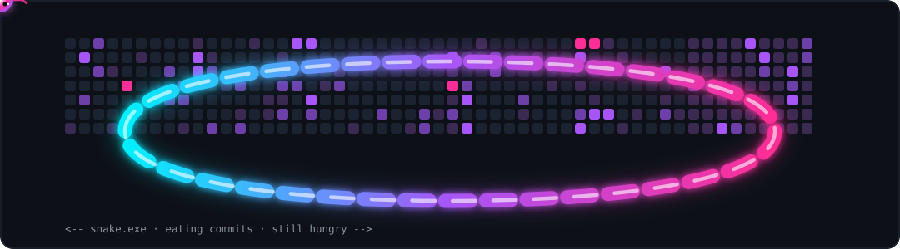

<!-- ═══════════════════════════════════════════════════════════════════════
     ANTONIO — GitHub profile README
     Cyberpunk edition. Replace Antkkorc with your GitHub username.
     All widgets auto-update. See SETUP.md for the 5-minute go-live.
     ═══════════════════════════════════════════════════════════════════════ -->

<div align="center">

<!-- ── ANIMATED HEADER ─────────────────────────────────────────────────── -->
<a href="https://github.com/Antkkorc">
  
</a>

<!-- ── TYPING ANIMATION ────────────────────────────────────────────────── -->
<a href="https://github.com/Antkkorc">
  
</a>

<!-- ── LIVE COUNTERS ───────────────────────────────────────────────────── -->


</div>

<br/>

<!-- ── ABOUT ───────────────────────────────────────────────────────────── -->

```ts
const antonio = {
  name:     "Antonio",
  title:    "Computer Scientist & Software Engineer",
  focus:    ["Full-Stack Web Development", "AI / Machine Learning", "Cybersecurity"],
  stack:    ["TypeScript", "React / Next.js", "Node.js", "Python", "PostgreSQL"],
  current:  "building systems that are fast, secure and actually useful",
  learning: ["deep learning", "distributed systems", "offensive security"],
  contact:  "antoniokealeboga1@gmail.com",
  motto:    "understand the system, then break it, then build it better",
};
```

<table>
<tr>
<td width="50%" valign="top">

### 🧠 Computer Scientist
I care about the *why* under the code — algorithms, data structures, complexity,
architecture. The theory is what makes the engineering not fall over in production.

</td>
<td width="50%" valign="top">

### 🤖 AI / Machine Learning
Training, fine-tuning and actually deploying models. From data cleaning to
inference at the edge — I like ML that ships, not ML that sits in a notebook.

</td>
</tr>
<tr>
<td width="50%" valign="top">

### 🌐 Full-Stack Web Developer
End-to-end ownership: pixel-tight React on the front, typed APIs and solid
database design on the back. Fast, accessible, maintainable.

</td>
<td width="50%" valign="top">

### 🔐 Cybersecurity
Threat modelling, network recon, and breaking my own code before someone else
does. Security isn't a feature you bolt on at the end.

</td>
</tr>
</table>

<!-- ── TECH ARSENAL ────────────────────────────────────────────────────── -->

<h2 align="center">⟨ tech arsenal ⟩</h2>

<div align="center">

<sub><b>frontend</b></sub><br/>


<sub><b>backend &amp; data</b></sub><br/>


<sub><b>AI / ML</b></sub><br/>


<sub><b>security &amp; systems</b></sub><br/>


</div>

<br/>

<!-- ── STATS ───────────────────────────────────────────────────────────── -->
<!-- THEME: bg 0d1117 · titles ff2d95 · icons 00f0ff · text c9d1d9 · accent a855f7
     WIDGET STATUS re-verified 2026-11-01, every URL below returns HTTP 200 with real data:
       · github-readme-stats.vercel.app     -> DEPLOYMENT_PAUSED  (dead, removed)
       · github-profile-trophy.vercel.app   -> DEPLOYMENT_DISABLED (dead, removed)
       · github-readme-activity-graph       -> DEPLOYMENT_DISABLED (dead, removed)
     Replaced with github-profile-summary-cards + ghchart, both live. If those ever die,
     re-run the probe before swapping anything back in. -->

<h2 align="center">⟨ signal ⟩</h2>

<!-- THEME SWITCHING — how this actually works (verified in a real browser, 2026-11-01):
     GitHub ships CSS of the form
       :root[data-color-mode="dark"] .readme [href$="#gh-light-mode-only"] { display:none }
     i.e. the fragment must be on an <a href>, NOT on . Putting #gh-dark-mode-only
     directly in an img src does nothing — both variants render. And <picture><source
     media="(prefers-color-scheme: dark)"> tracks the VIEWER'S OS, not their GitHub theme,
     which is why the earlier version showed light cards on a dark page.
     So: <a href="#gh-...-mode-only"></a> is the only construct that follows the
     viewer's real GitHub theme setting.

     Widget availability re-verified 2026-11-01 (all HTTP 200 with real data):
       github-readme-stats.vercel.app     DEPLOYMENT_PAUSED   -> removed
       github-profile-trophy.vercel.app   DEPLOYMENT_DISABLED -> removed
       github-readme-activity-graph       DEPLOYMENT_DISABLED -> removed
     Live replacements: github-profile-summary-cards + ghchart + streak-stats.demolab.com -->

<div align="center">

<a href="#gh-dark-mode-only"></a>
<a href="#gh-light-mode-only"></a>
<a href="#gh-dark-mode-only"></a>
<a href="#gh-light-mode-only"></a>
<a href="#gh-dark-mode-only"></a>
<a href="#gh-light-mode-only"></a>
<br/><br/>

<a href="#gh-dark-mode-only"></a>
<a href="#gh-light-mode-only"></a>
<br/><br/>

<a href="#gh-dark-mode-only"></a>
<a href="#gh-light-mode-only"></a>
</div>

<br/>

<!-- ── CONTRIBUTIONS ───────────────────────────────────────────────────── -->

<h2 align="center">⟨ contributions ⟩</h2>

<div align="center">

<a href="#gh-dark-mode-only"></a>
<a href="#gh-light-mode-only"></a>
</div>

<br/>

<!-- ── SNAKE ───────────────────────────────────────────────────────────── -->
<!-- assets/snake-dark.svg is a self-contained animated SVG (pure SMIL, no JS),
     so the snake really crawls. Swap in the live generated one from
     .github/workflows/snake.yml once you have real contribution data. -->

<h2 align="center">⟨ the snake eats my commits ⟩</h2>

<div align="center">



</div>

<br/>

<!-- ── CONNECT ─────────────────────────────────────────────────────────── -->

<h2 align="center">⟨ find me ⟩</h2>

<div align="center">

<a href="https://www.linkedin.com/in/antonio-koketso-18a184392">
  
</a>
<a href="mailto:antoniokealeboga1@gmail.com">
  
</a>
<a href="https://github.com/Antkkorc">
  
</a>

</div>

<br/>

<!-- ── FOOTER ──────────────────────────────────────────────────────────── -->


<div align="center">
<sub><code>// system.halt()</code> — thanks for stopping by 🖤</sub>
</div>
